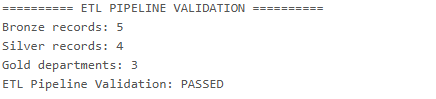
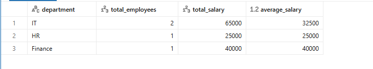

# 🚀 End-to-End ETL Pipeline Using Databricks

## 📌 Project Overview

This project demonstrates an end-to-end ETL
(Extract, Transform, Load) pipeline using Python,
PySpark, and Databricks.

The pipeline processes employee data through
Bronze, Silver, and Gold layers to improve data
quality and generate meaningful business insights.

## 🛠️ Technologies Used

- Python
- PySpark
- Apache Spark
- Databricks
- Spark SQL
- Delta Lake

## 🏗️ Project Architecture

The pipeline follows a Medallion Architecture:

### 🥉 1. Bronze Layer — Raw Data

- Stores the initial employee dataset.
- Preserves raw employee records.
- Acts as the source for downstream transformations.

### 🥈 2. Silver Layer — Cleaned Data

- Removes extra spaces using `trim()`.
- Removes duplicate records using `dropDuplicates()`.
- Improves data quality before further processing.

### 🥇 3. Gold Layer — Business Insights

Generates department-wise summary metrics:

- Total employees
- Total salary
- Average salary

These metrics help demonstrate basic business
reporting using Spark DataFrames.

## 🔄 ETL Workflow

1. Create employee sample data.
2. Load raw data into the Bronze Layer.
3. Clean text columns and remove duplicate rows.
4. Store the cleaned data in the Silver Layer.
5. Aggregate employee data by department.
6. Store the results in the Gold Layer.
7. Validate record counts and inspect final output.

## 📊 Final Results

| Layer | Records / Groups |
|-------|------------------|
| Bronze | 5 records |
| Silver | 4 records |
| Gold | 3 departments |

### Gold Layer Summary

| Department | Total Employees | Total Salary | Average Salary |
|------------|----------------:|-------------:|---------------:|
| IT | 2 | 65000 | 32500 |
| HR | 1 | 25000 | 25000 |
| Finance | 1 | 40000 | 40000 |

## ✅ Validation

The basic ETL validation completed successfully.

- Bronze record count: 5
- Silver record count: 4
- Gold department count: 3
- Validation status: PASSED

The validation checks record counts and confirms
that the expected Gold Layer output is available.

## 📁 Project Files

- `End-to-End ETL Pipeline Project.ipynb`
- `End_o_end_ETL_Project.ipynb`
- `README.md`

The notebooks contain the implementation and
outputs of the ETL pipeline.

## 🎯 Key Learning Outcomes

- Understanding ETL pipeline development.
- Working with PySpark DataFrames.
- Implementing data cleaning and deduplication.
- Using Bronze, Silver, and Gold data layers.
- Performing group-by aggregations.
- Saving and reading tables in Databricks.
- Validating pipeline output.

## 👩‍💻 Author

**Arshina Azam**

B.Tech in Computer Science and Engineering

GitHub: https://github.com/arshina-azam

---

⭐ If you find this project useful, consider
starring the repository!

## 📸 Project Output

### ETL Pipeline Validation

### Gold Layer Output

